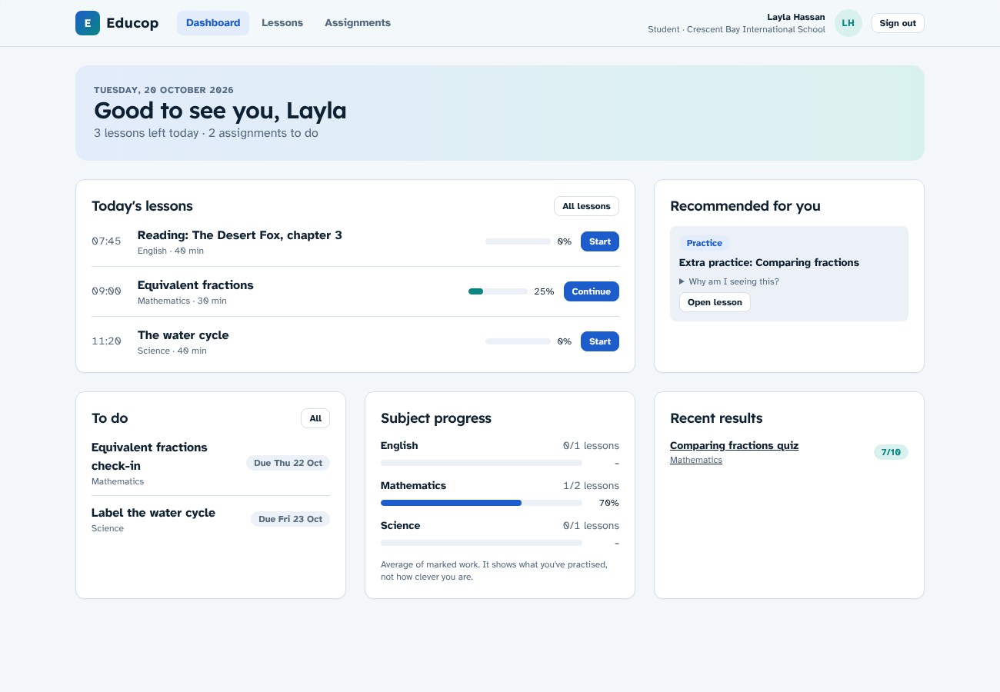

# Educop

Educop is an AI-powered KG–12 learning platform. This app covers the MVP core and every module in the UI preview.

**MVP core**

- Sign-in with role-based dashboards (student, teacher, parent, school admin, platform admin)
- Student dashboard: today's lessons, to-do list, subject progress, recent results and recommendations
- Teacher dashboard: today's lessons, marking queue, recent results, recommendations to review, and students who may need support
- Daily lessons in the 8-part structure, with a lesson editor for teachers and a lesson player for students
- Assignments: builder (multiple choice and short answer), student submission, automatic marking, teacher marking, late policy, gradebook and question analysis
- A rule-based recommendation engine that runs whenever a submission is fully marked
- **Multi-school from day one**: organisations → schools → everything else, with data isolated per school

**Modules**

- **Students:** reasoning-skills practice in five areas (adaptive and growth-focused, never an IQ score), "My growth" (mood check-ins, reflections, goals and habits, private by default), "For you" (recommendations, points, badges and streak, with no leaderboards), and the Nova AI study buddy (Socratic hints, a safety screen, daily limit, parent consent).
- **Teachers:** an AI assistant that drafts lessons, quizzes, feedback, differentiated tasks and parent notes for the teacher to review; student progress with an objective heatmap, plus class skills and wellbeing summaries (anonymous, minimum group of 5); recommendation review with approve, modify, dismiss and manual suggestions.
- **Everyone:** a sidebar app shell, in-app notifications for real events, and settings and privacy (profile, password, accessibility, notification choices, parent consents per child, download my data, deletion request).
- **Parent–teacher messages:** each conversation is about one child. Messages containing contact details are held for moderation.
- **Virtual classroom:** schedule, start and end live classes, with attendance, raise hand, moderated chat and live polls. Video runs in Educop live (beta, on LiveKit), Microsoft Teams, Google Meet or an embedded Jitsi Meet room.
- **Recorded classes:** teachers share class videos (uploaded, linked or recorded in Teams/Meet and uploaded afterwards) with captions, chapters and in-video questions. Students watch in a custom player and their real watching is tracked; teachers see watched %, completion, question results and where students stop watching.
- **Parent portal:** a child switcher and per-child overview, plus a home learning page with a "we did this" tick.
- **School admin:** overview, people (add, deactivate, parent links, CSV roster import with a dry run), classes and subjects, lesson approvals, reports with CSV export, moderation, and school settings.
- **Platform admin:** schools and organisations (add a school with its first admin, suspend, plan and seats), AI usage, moderation across schools, and the audit log.

All demo people, schools and results are fictional.



---

## Run it locally

You need **Node.js 20+** and **PostgreSQL 14+**.

```bash
npm install
cp .env.example .env            # then set DATABASE_URL and SESSION_SECRET
npx prisma migrate deploy       # create the tables
npm run db:seed                 # load the two demo schools
npm run dev                     # http://localhost:3000
```

To get a SESSION_SECRET, run `openssl rand -base64 48`.

### Demo accounts

Every account uses the password **`Educop!2026`**. The login page lists them outside production.

| Role | Email | School |
|---|---|---|
| Student (Grade 5) | layla@crescentbay.example | Crescent Bay International School |
| Teacher | sara.mitchell@crescentbay.example | Crescent Bay |
| Parent of Layla and Adam | rania.hassan@example.com | Crescent Bay |
| School admin | admin@crescentbay.example | Crescent Bay |
| Teacher, second school | omar.farouk@palmgrove.example | Palm Grove Academy |
| Platform admin | platform@educop.example | All schools |

### Tests

```bash
npm test             # unit tests: grading, late policy, recommendations, route ownership
npm run build
npm run test:e2e     # end-to-end in Chromium: re-seeds the database, starts the app on port 3100
```

The end-to-end suite covers the full loop. A student completes a lesson and submits an assignment. The teacher marks the short answer and approves a stretch suggestion, and the student sees the result. It also covers a teacher building and publishing a lesson and an assignment, wrong-password handling, role redirects, the parent view, the platform view, and **cross-school isolation** (a Palm Grove teacher gets a 404 on a Crescent Bay assignment URL).

---

## Technology choices

| Layer | Choice | Why |
|---|---|---|
| App | Next.js 15 (App Router), React 19, TypeScript | One codebase for UI and server logic. Server Components keep data access on the server. |
| Styling | Tailwind CSS 3, design tokens in `globals.css` | Same blue and teal palette as the UI preview, with automatic dark mode |
| Database | PostgreSQL + Prisma 6 | Relational data (schools, classes, enrolments), typed queries and migrations |
| Auth | Email and password (bcrypt) plus a signed JWT in an httpOnly cookie (jose) | No external dependency for the MVP. SSO (Microsoft, Google, UAE Pass) can be added behind the same session shape. |
| Validation | zod on every server action | |
| Tests | Vitest (unit), Playwright (end-to-end) | |

This is deliberately the simplest stack that can carry the product: no separate API service, queue or cache yet.

## How the code is organised

```
prisma/schema.prisma        data model (multi-school)
prisma/seed.ts              two fictional schools in two organisations
src/middleware.ts           blocks the wrong role at the URL level
src/lib/auth.ts             requireRole(): server-side guard used by every page and action
src/lib/data.ts             ALL reads: scoped by schoolId + relationship (enrolled / teaches / parent of)
src/lib/grading.ts          pure marking rules (auto-mark, late days, penalty, totals)
src/lib/recommend.ts        pure recommendation rules with evidence
src/lib/recordings.ts       pure recorded-class rules: video links, watched ranges, captions
src/lib/livekit*.ts         Educop live: who may do what (pure) and LiveKit tokens and room control (server)
src/lib/submit.ts           re-scores a submission and triggers recommendations once
src/app/student/…           dashboard, lessons, lesson player, assignments
src/app/teacher/…           dashboard, lesson editor, assignment builder, gradebook, marking
src/app/parent|admin|platform  first versions of the other roles' home pages
```

## Multi-school design

- **Organisation → School → (users, subjects, classes, lessons, assignments, audit log).** A school group can run several schools, and independent schools are an organisation of one.
- Every school-owned row has a `schoolId`. Users belong to one school, and only the platform admin has `schoolId = null`.
- The session carries `schoolId`. Every query in `src/lib/data.ts` and every server action filters by it **and** by the user's relationship to the record. A teacher must teach the class, a student must be enrolled, and a parent must have a verified link. Guessing an id from another school or class returns 404.
- The platform admin sees per-school totals, not student records.
- School-level settings already in the model: curriculum label, time zone, academic years and active/suspended status. A suspended school's users can't sign in.
- **Adding a school today** means inserting an organisation and a school, then users and classes. See `prisma/seed.ts` for the shape. A platform-admin "Add school" screen and CSV roster import are next.
- **Later options** if a client needs them: Postgres row-level security as a second line of defence, or a separate database per large school group. The `schoolId` column makes either possible without changing the app's queries much.

## Recommendation engine (MVP rules)

When a submission is fully marked, `src/lib/recommend.ts` suggests:

| Score | Suggestion | Visible to student |
|---|---|---|
| below 60% | Review the linked lesson | Immediately |
| 60–85% | Extra practice on the topic | Immediately |
| 90% and above | Challenge task | **After teacher approval** |

Each suggestion stores its evidence ("Comparing fractions quiz: 4/10 (40%)") and shows it to the student under "Why am I seeing this?". Teachers also see students below 60% in a support list, worded as a prompt for a check-in, not a label.

## Security already in place

- bcrypt password hashes, constant-time response for unknown emails, 5 failed sign-ins per 15 minutes per email and IP
- httpOnly, SameSite=Lax session cookie (Secure in production), 12-hour expiry
- Role check in middleware **and** again next to every data access
- Answer keys never reach the browser before a student submits
- zod validation and length limits on all input, and server actions protected by Next.js origin checks
- Audit log for sign-ins, content changes, submissions, marking and recommendation decisions
- Security headers (frame-deny, nosniff, referrer and permissions policy)

## Educop live (beta)

Built-in live video for the virtual classroom, on [LiveKit](https://livekit.io). It's a free test version: it runs on LiveKit Cloud's free plan and records in the teacher's browser, so nothing costs money until you outgrow the free plan.

**Turn it on**

1. Create a free project at [cloud.livekit.io](https://cloud.livekit.io).
2. In the project's settings, copy the **WebSocket URL** (`wss://…livekit.cloud`) and create an **API key** and **secret**.
3. In Vercel → Project → Settings → Environment Variables, add `LIVEKIT_URL`, `LIVEKIT_API_KEY` and `LIVEKIT_API_SECRET` (see `.env.example`), then redeploy.

Without all three, "Educop live (beta)" appears in the video menu but can't be chosen ("Needs a LiveKit account (free plan works)"). Once set, it's the default for new classes.

**Free plan limits.** The free plan includes a monthly allowance of participant-minutes (about 5,000 a month according to third-party sources; one student in a 40-minute class uses 40). Check the [LiveKit pricing page](https://livekit.io/pricing) for the current limits before running real classes.

**How it works**

- `src/lib/livekit.ts` (server only) issues each person their own access token for the class room: 2 hours, identity = user id, name, and a role in the metadata. The API key and secret never reach the browser. `POST /api/live/[id]/token` gives a token only to the class teacher, or to an enrolled student who has pressed "Join class" (so attendance is recorded), and only while the class is live.
- **Teacher:** camera, microphone, screen share and room admin. **Students:** watch, listen and send data; they can't publish until the teacher presses **Invite to speak** in People (mic, and camera if they choose). **Stop** takes it back and LiveKit removes their tracks. **Mute all** mutes every student mic. The invitation is saved, so a student who reconnects keeps it. Ending the class closes the LiveKit room.
- The stage (`src/components/live/EducopStage.tsx`) uses `livekit-client` with adaptive stream and dynacast. The main view is the teacher's screen share, or else their camera, with a strip of students who are speaking. It shows connection quality, full screen, a "Click to enable sound" button when the browser blocks autoplay, and reconnecting and can't-connect states. Students can switch on **Low-bandwidth mode**, which turns off camera video but keeps screen share and audio.
- **Free recording:** the teacher's **Record** button records the main stage (screen share, or else camera, plus the teacher's mic) in their browser as WebM (VP8 and Opus). In Chrome and Edge the recording follows the stage when screen sharing starts or stops. On stop it uploads to Vercel Blob and opens the recording form, prefilled, in a new tab, to save as a draft. Without `BLOB_READ_WRITE_TOKEN` the teacher gets a **Download recording** button and can upload the file later. LiveKit's paid cloud recording (egress) isn't used.
- Attendance, hands, chat and polls are unchanged: Educop stores them and the page polls every 5 seconds.

**Not tested against a real LiveKit server here.** Unit tests check the token grants by decoding real signed tokens. The end-to-end test runs with fake LiveKit settings. It covers scheduling, the stage's "Couldn't connect to the live video service" state, joining and attendance, invite to speak and the token rules. Real audio and video, screen share, Mute all and recording need a LiveKit project to try out.

## Recorded classes

Teachers add a recording at **Recorded classes → New recording**, or from an ended live class with "Add the class recording". A recording has a video, optional WebVTT captions (or plain lines like `00:12 text`, converted to WebVTT), chapters and multiple-choice questions at set times.

- **Video source.** With `BLOB_READ_WRITE_TOKEN` set (connect a Vercel Blob store to the project), teachers upload `.mp4`, `.webm` or `.mov` files up to 2 GB straight from the browser to Blob storage. `/api/recordings/upload` only issues upload tokens to signed-in teachers. Uploaded files get a random, unguessable name, but Blob URLs are public, so don't upload anything that must stay private. Without the token, upload is hidden and teachers paste an https link that goes straight to a video file. YouTube, Teams and Drive pages aren't video files and are refused with an explanation. The seeded demo uses a short fictional lesson video in `public/media/`.
- **Player** (`src/components/media/VideoPlayer.tsx`): custom controls (seek bar with buffered range, chapter and question markers, speed, volume, captions, full screen, picture-in-picture), keyboard shortcuts, chapters and a transcript you can click to jump.
- **Questions** pause the video. Students can't seek past a question they haven't answered. Answers are checked on the server, so the answer key never reaches the browser first.
- **Progress** is saved about every 10 seconds and on pause, end and leaving the page. "Watched" is the merged set of seconds actually played, so skipping ahead doesn't count, and one save can only add about as much as the time that has passed. At 90% watched with every question answered, the video is complete and the student earns 15 points.

## AI

AI features call Claude through `src/lib/ai.ts` when `ANTHROPIC_API_KEY` is set (model from `AI_MODEL`, default `claude-opus-5-5`). Without a key, every AI screen still works with clearly labelled template suggestions. A school admin can switch AI off for their school. Teacher-facing AI output is always a draft the teacher edits and accepts.

## Not built yet (next phases)

- Password reset, SSO and MFA for staff
- Email, push and SMS delivery (preferences are saved; in-app notifications work)
- Breakout rooms and a whiteboard in Educop live, and server-side recording (LiveKit egress, a paid feature)
- Billing
- File uploads (private object storage), question banks, rubrics
- Production rate limiting across several servers (the current limiter is per process)
- Legal review of UAE data-protection requirements before handling real student data

## Deployment notes

Any Node host with PostgreSQL works (for example a managed Postgres plus a container or Node service). Run `npx prisma migrate deploy` on release, set `NODE_ENV=production`, `DATABASE_URL` and a strong `SESSION_SECRET`, The preview runs in Frankfurt (`fra1`) next to the Neon database. For real student data, move the app and database to a UAE or GCC region if the school requires data residency. `/api/health` returns 200 when the app can reach the database.
